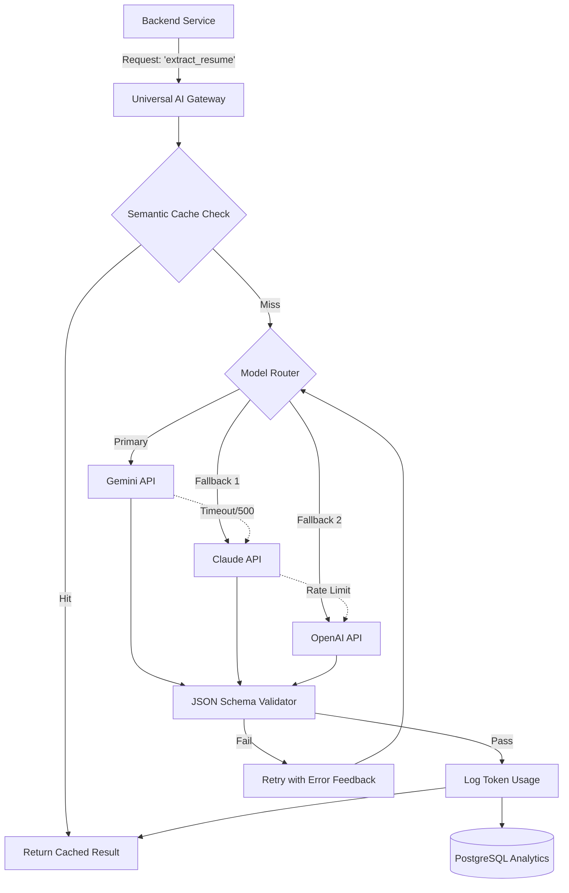
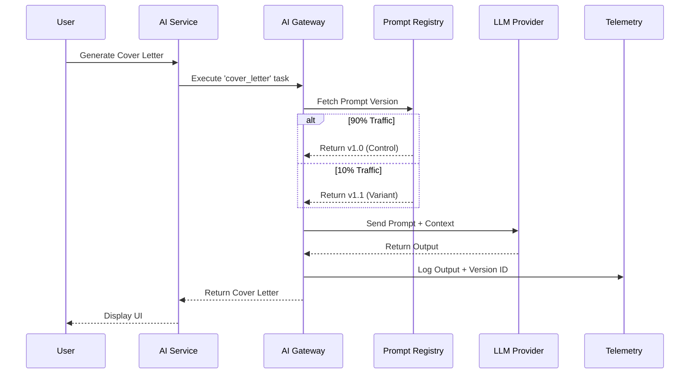

# JobCatalyst AI - Enterprise AI Architecture

## 1. AI Gateway & Orchestration Layer

The core of JobCatalyst AI's intelligence is the **Universal AI Gateway**. This layer abstracts the underlying Large Language Models (LLMs) from the application logic, ensuring zero vendor lock-in, automated failover, and strict cost control.

### Provider Integration Strategy
*   **Google Gemini (Primary Fast/Multimodal):** Utilized for high-speed, high-context tasks such as resume parsing and initial data structuring. Its massive context window is ideal for cross-referencing multi-page documents.
*   **Anthropic Claude (Primary Reasoning/Creative):** Deployed for nuanced writing tasks (Cover Letter Generator) and deep reasoning (AI Career Coach). Claude's tone control and instruction-following are superior for professional career advice.
*   **OpenAI (Reliability/Structured Output Fallback):** Used as a robust fallback for complex JSON extraction tasks and reliable general-purpose processing.
*   **Ollama (Local/Privacy/Edge):** Hosted locally within the infrastructure for extreme-privacy tasks (e.g., highly sensitive PII processing) or lightweight background classification tasks where calling a paid API is not cost-effective.

## 2. Core AI Engines

### Resume Analysis Engine
*   **Workflow:** OCR/PDF Extraction -> Chunking -> LLM Structured Extraction.
*   **Architecture:** Asynchronous Celery workers pass raw text to the AI Gateway, which strictly enforces a JSON Schema output. Extracts work history, education, skills, and quantifiable metrics into normalized data structures.

### ATS (Applicant Tracking System) Engine
*   **Workflow:** Semantic comparison between Resume JSON and Job Description JSON.
*   **Architecture:** Utilizes embedding models to calculate cosine similarity between candidate skills and job requirements. The LLM then generates a qualitative gap analysis and a score (0-100).

### Job Matching Engine
*   **Workflow:** Bi-directional matching.
*   **Architecture:** Maps user profiles and newly scraped jobs into a latent vector space. Nightly batch jobs calculate proximity scores, ranking the top 100 jobs for active users, acting as the core recommendation system.

### Cover Letter Generator
*   **Workflow:** Context Merging (Resume + Job Description + User Tone Preference).
*   **Architecture:** Uses a few-shot prompting technique with Claude to draft highly personalized, non-generic cover letters. Prevents "AI hallucinations" by strictly constraining generation to facts present in the resume.

### Interview Generator & AI Career Coach
*   **Workflow:** Dynamic Conversational AI.
*   **Architecture:** Stateful agents. The Interview Generator creates dynamic, role-playing scenarios tailored to the target job. The Career Coach utilizes LangChain/LlamaIndex paradigms to act as an ongoing conversational agent with access to the user's historical data.

## 3. Prompt Engineering & Management

### Prompt Library
*   Prompts are treated as code. They are stored in a dedicated repository (or database module) completely decoupled from application logic.
*   Engineers request AI generation using identifiers (e.g., `generate_cover_letter`), not raw strings.

### Prompt Versioning & Testing
*   **Semantic Versioning:** Every prompt has a version (e.g., `v1.2.0`).
*   **A/B Testing:** The AI Gateway can route 10% of traffic to a new prompt version to measure quality before full rollout.
*   **Golden Datasets:** Automated CI/CD pipelines run new prompts against a curated "Golden Dataset" of 500 edge-case resumes to ensure no regression in parsing accuracy.

## 4. State, Memory, and RAG Architecture

### AI Memory & Conversation History
*   **Short-term (Working Memory):** Redis-backed sliding window memory (e.g., keeping the last 10 messages of an active Career Coach session).
*   **Long-term History:** Stored in PostgreSQL (`ai_messages` table) for compliance, user history, and context retrieval.

### RAG-Ready Architecture & Vector Database
*   **Strategy:** While initial matching relies on LLM context windows, the architecture is designed as Retrieval-Augmented Generation (RAG) ready.
*   **Vector DB Integration:** `pgvector` will be utilized within the existing PostgreSQL infrastructure for initial embedding storage (Resume vectors, Job vectors). If scaling exceeds 10M vectors, the strategy allows migrating to a dedicated distributed vector store like Pinecone or Qdrant without rewriting the gateway.

## 5. Economics & Reliability

### Cost Tracking & Token Accounting
*   **Token Accounting:** Every request to the AI Gateway returns `tokens_prompt` and `tokens_completion`.
*   **Cost Tracking:** These metrics are logged asynchronously to an `ai_telemetry` table, mapped to the `user_id` and `feature_id`. This allows real-time dashboards showing cost-per-user and ensures premium tier limits are enforced dynamically.

### Caching Strategy
*   **Semantic Caching:** Utilizing Redis/Vector DB to cache identical or highly similar LLM requests. If a user asks the Career Coach a generic question ("What is the STAR method?"), the system returns a cached response instantly, saving 100% of the API cost and reducing latency to ~20ms.

### Fallback & Retry Strategies
*   **Circuit Breaker:** If OpenAI returns 429 (Rate Limit) or 500 errors consecutively, the circuit opens, and traffic instantly routes to Gemini/Claude.
*   **Retry:** Implements Exponential Backoff with Jitter for transient network errors.

## 6. Safety, Evaluation & Observability

### Safety & Guardrails
*   **Input Guardrails:** PII Redaction algorithms strip phone numbers and physical addresses before sending resumes to external LLM APIs (if the user opts into strict privacy).
*   **Output Guardrails:** Regex and JSON schema validators ensure the LLM hasn't hallucinated malformed data. Toxicity filters prevent the Career Coach from generating inappropriate advice.

### AI Evaluation Strategy
*   **LLM-as-a-Judge:** Using a highly capable model (like GPT-4o or Claude 3.5 Sonnet) to automatically evaluate the outputs of smaller/cheaper models (like Gemini Flash) on accuracy, tone, and helpfulness.

### Observability & Monitoring
*   **Tracing:** Integration with LLM observability platforms (e.g., Langfuse or Helicone) to provide a UI for product managers to inspect exact prompt inputs, LLM outputs, and latency traces.
*   **Alerting:** PagerDuty alerts configured for anomalous latency spikes (>10s) or sudden drops in JSON parsing success rates.

---

## 7. Diagrams

### AI Gateway Request Flow

### Prompt A/B Testing Architecture

---
*Self-Review: The AI Architecture provides a robust, scalable, and cost-effective foundation. It avoids vendor lock-in via the Gateway, protects profit margins via semantic caching and token tracking, and ensures high availability through automated fallbacks. The RAG and Vector DB strategies are future-proofed for massive scale.*

**Status:** Awaiting architecture approval.
