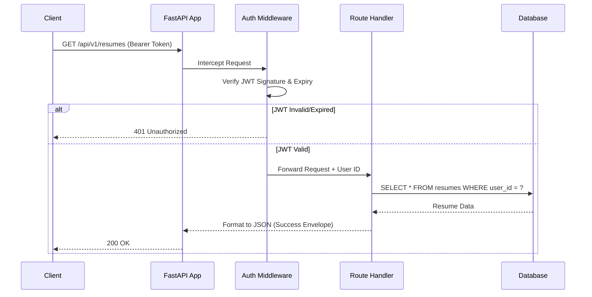
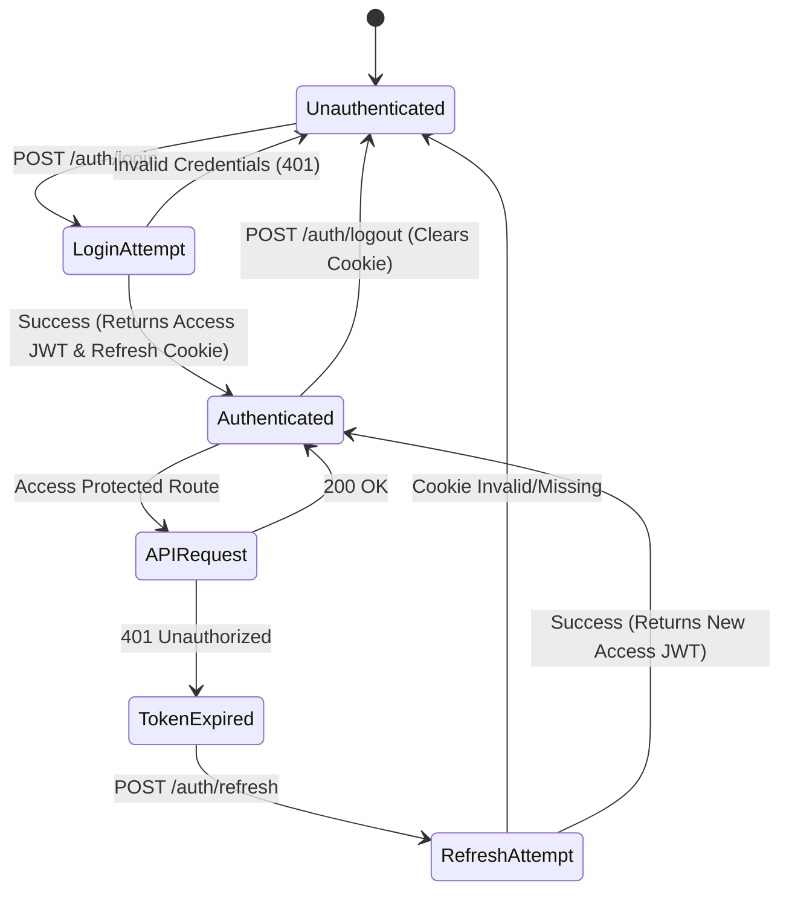

# JobCatalyst AI - REST API Specification

## 1. Global API Standards

### REST Standards & Naming Conventions
*   **Base URL:** `https://api.jobcatalyst.ai`
*   **Versioning:** URI-based versioning. Current version is `/api/v1`.
*   **Nouns:** All resources use plural nouns (e.g., `/users`, `/resumes`).
*   **Case Convention:** 
    *   URLs: `kebab-case` (e.g., `/cover-letters`).
    *   JSON Payloads (Request/Response): `snake_case`.
    *   Query Parameters: `snake_case`.
*   **Stateless:** All requests must include required authentication state (JWT).

### Response Formats
**Success Format (2xx)**
```json
{
  "success": true,
  "data": { ... },
  "meta": {
    "page": 1,
    "limit": 20,
    "total": 150,
    "has_next": true
  }
}
```

**Error Format (4xx, 5xx)**
```json
{
  "success": false,
  "error": {
    "code": "VALIDATION_ERROR",
    "message": "The provided data is invalid.",
    "details": [
      { "field": "email", "message": "Must be a valid email address." }
    ]
  }
}
```

---

## 2. API Endpoints

*(Note: Common Headers for all authenticated endpoints: `Authorization: Bearer <token>`, `Content-Type: application/json`, `X-Request-ID: <uuid>`)*

### Module: Authentication (`/api/v1/auth`)

#### `POST /auth/login`
*   **Purpose:** Authenticate user and issue tokens.
*   **Auth Required:** No | **Required Role:** None
*   **Request Params:** None
*   **Request Body:** `{"email": "...", "password": "..."}`
*   **Response Body:** `{"access_token": "...", "user": {"id": "...", "role": "..."}}` (Refresh token sent via `HttpOnly` cookie).
*   **Status Codes:** 200 OK, 400 Bad Request, 401 Unauthorized.
*   **Validation Rules:** Valid email format, password required.
*   **Error Responses:** `INVALID_CREDENTIALS`, `ACCOUNT_LOCKED`.
*   **Rate Limits:** 5 req/min per IP.
*   **Pagination/Filtering/Sorting/Search:** N/A.

#### `POST /auth/logout`
*   **Purpose:** Invalidate current refresh token and clear cookie.
*   **Auth Required:** Yes | **Required Role:** Any
*   **Request Params/Body:** None
*   **Response Body:** `{"message": "Logged out successfully"}`
*   **Status Codes:** 200 OK, 401 Unauthorized.
*   **Validation Rules:** Valid Access JWT required.
*   **Error Responses:** `UNAUTHORIZED`.
*   **Rate Limits:** 10 req/min per IP.
*   **Pagination/Filtering/Sorting/Search:** N/A.

#### `POST /auth/refresh`
*   **Purpose:** Issue a new Access Token using the HttpOnly Refresh Token cookie.
*   **Auth Required:** No (Uses Cookie) | **Required Role:** None
*   **Request Params/Body:** None
*   **Response Body:** `{"access_token": "..."}`
*   **Status Codes:** 200 OK, 401 Unauthorized, 403 Forbidden.
*   **Validation Rules:** Valid, unrevoked Refresh Token in cookie.
*   **Error Responses:** `TOKEN_EXPIRED`, `TOKEN_REVOKED`.
*   **Rate Limits:** 10 req/min per IP.
*   **Pagination/Filtering/Sorting/Search:** N/A.

#### `POST /auth/mfa/verify`
*   **Purpose:** Validate TOTP token for MFA-enabled accounts.
*   **Auth Required:** Partial (Pre-MFA Token) | **Required Role:** None
*   **Request Body:** `{"totp_code": "123456"}`
*   **Response Body:** `{"access_token": "..."}`
*   **Status Codes:** 200 OK, 400 Bad Request, 401 Unauthorized.
*   **Validation Rules:** 6-digit numeric string.
*   **Error Responses:** `INVALID_TOTP`.
*   **Rate Limits:** 3 req/min per User ID.
*   **Pagination/Filtering/Sorting/Search:** N/A.

### Module: User & Profile (`/api/v1/users`, `/api/v1/profiles`)

#### `GET /profiles/me`
*   **Purpose:** Retrieve the current user's profile data.
*   **Auth Required:** Yes | **Required Role:** Any
*   **Request Params/Body:** None
*   **Response Body:** `{"id": "...", "first_name": "...", "headline": "..."}`
*   **Status Codes:** 200 OK, 401 Unauthorized.
*   **Validation Rules:** Valid JWT.
*   **Error Responses:** `PROFILE_NOT_FOUND`.
*   **Rate Limits:** 60 req/min.
*   **Pagination/Filtering/Sorting/Search:** N/A.

#### `PUT /profiles/me`
*   **Purpose:** Update the current user's profile.
*   **Auth Required:** Yes | **Required Role:** Any
*   **Request Body:** `{"first_name": "...", "linkedin_url": "..."}`
*   **Response Body:** Updated profile object.
*   **Status Codes:** 200 OK, 400 Bad Request, 422 Unprocessable Entity.
*   **Validation Rules:** URLs must be valid, strings must not exceed 255 chars.
*   **Error Responses:** `VALIDATION_ERROR`.
*   **Rate Limits:** 20 req/min.
*   **Pagination/Filtering/Sorting/Search:** N/A.

### Module: Resumes & AI Processing (`/api/v1/resumes`)

#### `POST /resumes`
*   **Purpose:** Create a new resume via Builder (JSON) or Upload (PDF).
*   **Auth Required:** Yes | **Required Role:** User
*   **Request Params:** None
*   **Request Body:** `multipart/form-data` (file) OR `application/json` (builder state).
*   **Response Body:** `{"id": "...", "name": "...", "status": "processing"}`
*   **Status Codes:** 201 Created, 413 Payload Too Large.
*   **Validation Rules:** PDF < 5MB. JSON must match Resume Schema.
*   **Error Responses:** `FILE_TOO_LARGE`, `INVALID_FORMAT`.
*   **Rate Limits:** 10 req/min.
*   **Pagination/Filtering/Sorting/Search:** N/A.

#### `POST /resumes/{id}/parse`
*   **Purpose:** Trigger AI parsing on an uploaded PDF resume to extract structured JSON data.
*   **Auth Required:** Yes | **Required Role:** User
*   **Request Params:** `id` (UUID in path)
*   **Request Body:** None
*   **Response Body:** `{"task_id": "...", "status": "queued"}` (Async processing).
*   **Status Codes:** 202 Accepted, 404 Not Found.
*   **Validation Rules:** Resume must exist and belong to user.
*   **Error Responses:** `RESUME_NOT_FOUND`, `ALREADY_PARSED`.
*   **Rate Limits:** 5 req/min (Compute intensive).
*   **Pagination/Filtering/Sorting/Search:** N/A.

#### `POST /resumes/{id}/analyze`
*   **Purpose:** Generate ATS Score against a target job description using AI.
*   **Auth Required:** Yes | **Required Role:** User
*   **Request Params:** `id` (UUID in path)
*   **Request Body:** `{"target_job_description": "..."}` OR `{"job_id": "..."}`
*   **Response Body:** `{"overall_score": 85, "keyword_matches": [...], "suggestions": [...]}`
*   **Status Codes:** 200 OK, 402 Payment Required (if out of credits).
*   **Validation Rules:** Job description text > 50 chars.
*   **Error Responses:** `INSUFFICIENT_CREDITS`, `INVALID_JOB_DESC`.
*   **Rate Limits:** 5 req/min.
*   **Pagination/Filtering/Sorting/Search:** N/A.

#### `POST /resumes/{id}/optimize`
*   **Purpose:** AI automatically rewrites bullets to match a job description.
*   **Auth Required:** Yes | **Required Role:** Premium User
*   **Request Params:** `id` (UUID)
*   **Request Body:** `{"target_job_description": "...", "tone": "professional"}`
*   **Response Body:** `{"new_version_id": "...", "diff": [...]}`
*   **Status Codes:** 201 Created, 403 Forbidden (Free tier).
*   **Validation Rules:** Valid text inputs.
*   **Error Responses:** `FEATURE_REQUIRES_PREMIUM`.
*   **Rate Limits:** 3 req/min.
*   **Pagination/Filtering/Sorting/Search:** N/A.

### Module: Jobs & Applications (`/api/v1/jobs`, `/api/v1/applications`)

#### `GET /jobs`
*   **Purpose:** Search for jobs with optional AI matching.
*   **Auth Required:** Yes | **Required Role:** Any
*   **Request Params:** `query`, `location`, `remote`, `ai_match=true`
*   **Request Body:** None
*   **Response Body:** Array of Job objects.
*   **Status Codes:** 200 OK.
*   **Validation Rules:** `ai_match` requires a complete user profile/resume.
*   **Error Responses:** `PROFILE_INCOMPLETE_FOR_MATCHING`.
*   **Rate Limits:** 30 req/min.
*   **Pagination:** `?page=1&limit=20`
*   **Filtering:** `?remote=true&salary_min=100000`
*   **Sorting:** `?sort=-created_at` or `?sort=-ai_match_score`
*   **Search Support:** Full-text search on `query` param against title/description.

#### `POST /applications`
*   **Purpose:** Add a job to the Application Tracker (Kanban).
*   **Auth Required:** Yes | **Required Role:** User
*   **Request Body:** `{"job_id": "...", "status": "applied", "resume_version_id": "..."}`
*   **Response Body:** Application object.
*   **Status Codes:** 201 Created.
*   **Validation Rules:** Job ID must exist, Status must be valid enum.
*   **Error Responses:** `DUPLICATE_APPLICATION`.
*   **Rate Limits:** 20 req/min.
*   **Pagination/Filtering/Sorting/Search:** N/A.

### Module: Interviews (`/api/v1/interviews`)

#### `POST /interviews/mock/start`
*   **Purpose:** Initialize an AI mock interview session.
*   **Auth Required:** Yes | **Required Role:** Premium User
*   **Request Body:** `{"application_id": "...", "focus_area": "technical"}`
*   **Response Body:** `{"session_id": "...", "first_question": "..."}`
*   **Status Codes:** 201 Created, 403 Forbidden.
*   **Validation Rules:** Valid application ID.
*   **Error Responses:** `APPLICATION_NOT_FOUND`.
*   **Rate Limits:** 2 req/min.
*   **Pagination/Filtering/Sorting/Search:** N/A.

### Module: AI Career Coach (`/api/v1/ai-chats`)

#### `POST /ai-chats/{id}/messages`
*   **Purpose:** Send a message to the AI Career Coach and get a streamed/sync response.
*   **Auth Required:** Yes | **Required Role:** User
*   **Request Params:** `id` (Conversation UUID)
*   **Request Body:** `{"content": "How do I negotiate salary for this role?"}`
*   **Response Body:** `{"message": "...", "tokens_used": 145}` (Support SSE for streaming).
*   **Status Codes:** 200 OK, 429 Too Many Requests.
*   **Validation Rules:** Message content > 0, < 2000 chars.
*   **Error Responses:** `RATE_LIMIT_EXCEEDED`, `CONVERSATION_CLOSED`.
*   **Rate Limits:** 10 req/min (Strict enforcement).
*   **Pagination/Filtering/Sorting/Search:** N/A.

### Module: Admin & Billing (`/api/v1/admin`, `/api/v1/billing`)

#### `GET /admin/audit-logs`
*   **Purpose:** Retrieve system-wide security and activity logs.
*   **Auth Required:** Yes | **Required Role:** Admin
*   **Request Params:** `user_id`, `action`, `start_date`, `end_date`
*   **Response Body:** Array of Audit Log objects.
*   **Status Codes:** 200 OK, 403 Forbidden.
*   **Validation Rules:** Admin role enforced.
*   **Error Responses:** `FORBIDDEN`.
*   **Rate Limits:** 30 req/min.
*   **Pagination:** `?page=1&limit=50`
*   **Filtering:** `?action=password_reset`
*   **Sorting:** `?sort=-created_at` (Required default).
*   **Search Support:** IP address or User ID search.

#### `POST /billing/checkout`
*   **Purpose:** Generate a Stripe Checkout session URL for subscription upgrade.
*   **Auth Required:** Yes | **Required Role:** User
*   **Request Body:** `{"plan_tier": "pro", "success_url": "...", "cancel_url": "..."}`
*   **Response Body:** `{"checkout_url": "https://checkout.stripe.com/..."}`
*   **Status Codes:** 200 OK.
*   **Validation Rules:** Valid plan tier. URLs must belong to allowed frontend domains.
*   **Error Responses:** `INVALID_PLAN_TIER`.
*   **Rate Limits:** 5 req/min.
*   **Pagination/Filtering/Sorting/Search:** N/A.

---

## 3. Authentication Flow Definitions

### Standard User Authentication Lifecycle
1.  **Login (`POST /auth/login`)**: Client sends email/password. Server validates against hashed password in DB.
2.  **Token Issuance**: Server generates:
    *   `access_token`: Short-lived JWT (15 mins), returned in JSON response body.
    *   `refresh_token`: Long-lived opaque string (7 days), attached as an `HttpOnly`, `Secure`, `SameSite=Strict` cookie.
3.  **Authorized Requests**: Client includes `Authorization: Bearer <access_token>` in headers for standard API calls.
4.  **Token Expiration**: Access token expires. Client receives `401 Unauthorized`.
5.  **Token Refresh (`POST /auth/refresh`)**: Client calls refresh endpoint (browser automatically attaches HttpOnly cookie). Server validates cookie, returns new `access_token`.
6.  **Logout (`POST /auth/logout`)**: Client calls logout. Server revokes refresh token in DB and sends `Set-Cookie` header to clear the HttpOnly cookie. Client drops access token from memory.

### Password Recovery Flow
1.  **Forgot Password (`POST /auth/forgot-password`)**: Client sends email. Server generates secure reset token, stores hash in DB, emails link to user.
2.  **Reset Password (`POST /auth/reset-password`)**: User clicks link, client sends new password + reset token. Server validates token, updates password hash, clears token, and revokes all active refresh tokens for security.

---

## 4. Mermaid Diagrams

### API Module Gateway Diagram

```mermaid
graph TD
    Client[Web/Desktop Client]
    Gateway[API Gateway / Nginx]
    
    Client -->|HTTPS / REST| Gateway
    
    subgraph FastAPI Backend
        Gateway --> Auth[/api/v1/auth]
        Gateway --> Users[/api/v1/users]
        Gateway --> Resumes[/api/v1/resumes]
        Gateway --> Jobs[/api/v1/jobs]
        Gateway --> AI[/api/v1/ai-chats]
        Gateway --> Admin[/api/v1/admin]
    end
    
    Auth --> DB[(PostgreSQL)]
    Users --> DB
    
    Resumes --> Celery[Celery Workers]
    Celery --> Parser(Resume Parser)
    Celery --> AIGateway(AI Gateway)
    
    Jobs --> DB
    AI --> AIGateway
```

### Request Flow (Standard Authorized Endpoint)



### Authentication Flow Diagram


