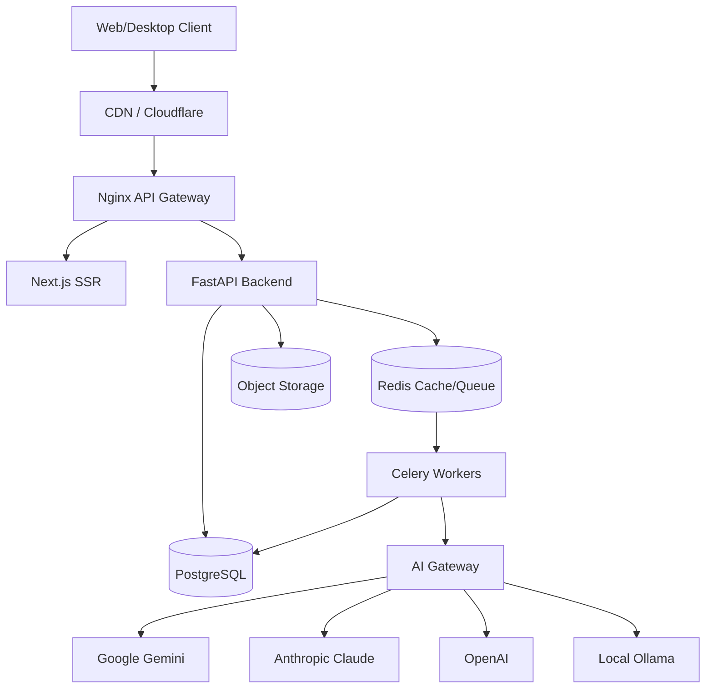
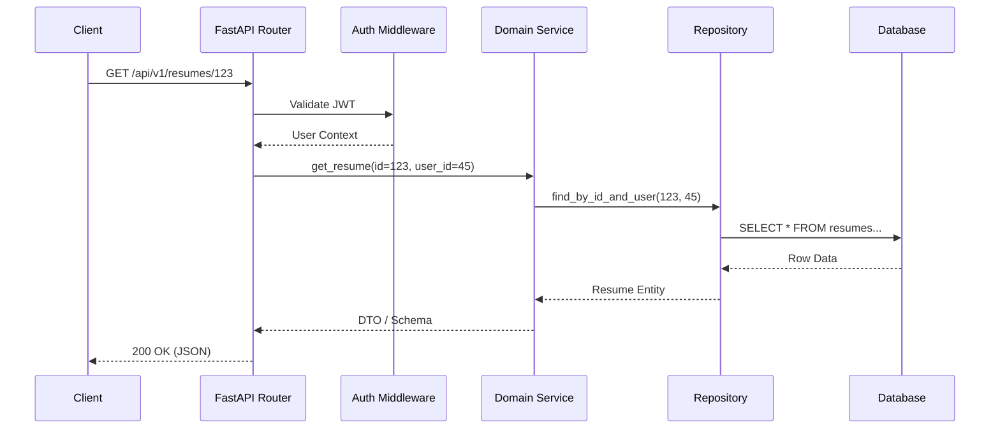
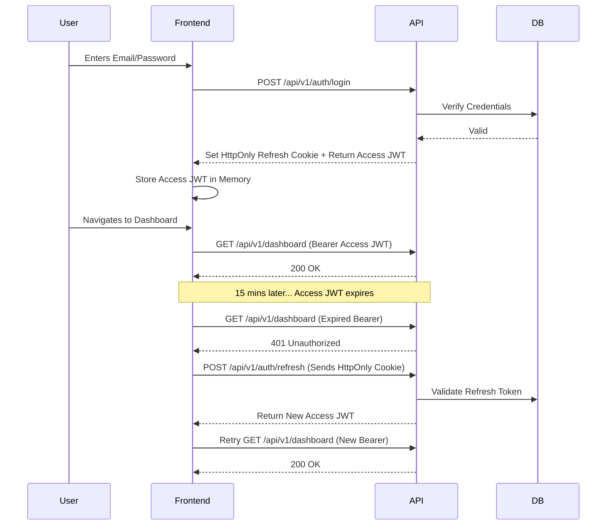
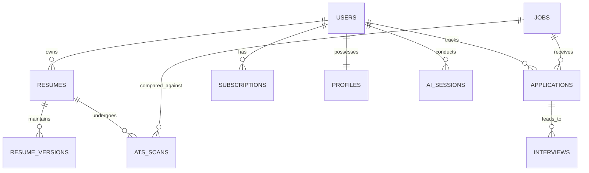
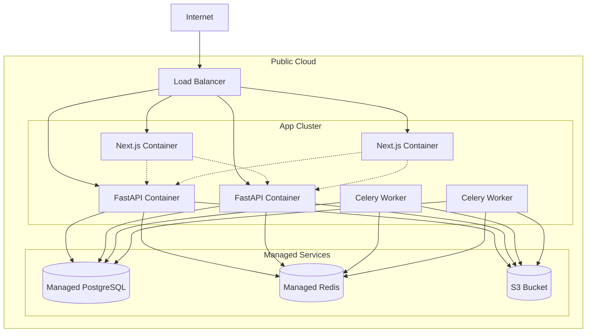

# JobCatalyst AI - Enterprise System Architecture

## 1. Overall Architecture

**Decision: Modular Monolith**

For JobCatalyst AI, we will adopt a **Modular Monolith** architecture for the initial production launch, designed with strict Domain-Driven Design (DDD) boundaries. 

**Reasoning:**
*   **Operational Simplicity:** A single codebase and deployment unit significantly reduces DevOps complexity, CI/CD overhead, and infrastructure costs during the critical growth phase.
*   **Logical Boundaries:** By strictly enforcing boundaries between domains (e.g., Auth, Resume Builder, AI Matching) via internal interfaces, we prevent spaghetti code.
*   **Performance:** In-memory function calls are orders of magnitude faster than network calls between microservices.
*   **Future-Proof:** When specific domains (like AI Processing or PDF Generation) require independent scaling, their modular nature allows them to be easily extracted into isolated microservices.

## 2. Backend Architecture

**Stack:** Python 3.13, FastAPI, SQLAlchemy 2, PostgreSQL, Redis, Celery

*   **Presentation Layer (API):** FastAPI routers defining REST endpoints. Handles HTTP requests, response formatting, and basic input validation (Pydantic).
*   **Middleware Layer:** Handles cross-cutting concerns: CORS, Rate Limiting, Request ID tracing, JWT Authentication parsing, and central exception handling.
*   **Authentication & Authorization Layer:** Role-Based Access Control (RBAC). Validates JWTs, checks permissions against resource scopes.
*   **Service Layer:** The core of the application. Contains all business logic. Orchestrates calls between repositories, AI services, and external APIs. Completely framework-agnostic where possible.
*   **Repository Layer:** Abstracts database interactions. The Service Layer never writes SQL or ORM queries directly; it calls methods like `resume_repo.get_by_id()`. Powered by SQLAlchemy 2.
*   **Database Layer:** PostgreSQL for relational data. Alembic for schema migrations.
*   **Worker Layer:** Celery workers for asynchronous tasks (e.g., parsing PDFs, calling LLMs, generating reports).
*   **Scheduler Layer:** Celery Beat for cron jobs (e.g., subscription renewals, daily job matches).
*   **AI Layer:** Provider factory that abstracts the underlying LLM (Gemini, Claude, OpenAI). Handles prompt injection, memory, and cost tracking.
*   **Infrastructure Layer:** Wrappers for external services (Email via SendGrid, Storage via AWS S3/MinIO).
*   **Configuration & Logging:** Pydantic BaseSettings for environment variables. Structured JSON logging (structlog) for observability.

## 3. Frontend Architecture

**Stack:** Next.js 15, React 19, TypeScript, Tailwind CSS, shadcn/ui, TanStack Query, Zustand

*   **Framework:** Next.js App Router for optimal SEO (marketing pages) and seamless client-side routing (dashboard).
*   **Pages & Layouts:** Server Components by default. Layouts handle persistent navigation (Sidebar, Topbar). Pages handle route-specific data fetching.
*   **Components:**
    *   *Shared Components:* Pure presentational components (Buttons, Inputs) built with shadcn/ui.
    *   *Feature Components:* Stateful, domain-specific components (e.g., `ResumeEditor`, `JobMatchCard`).
*   **State Management:**
    *   *Server State:* TanStack Query handles caching, deduplication, background updates, and pagination for API data.
    *   *Client State:* Zustand for global UI state (theme, sidebar toggle, multi-step form progress).
*   **API Client:** Axios or native fetch wrapped in a strongly typed SDK, intercepting requests to inject JWTs and handling 401 refresh token logic.
*   **Error Boundaries:** React Error Boundaries to catch rendering errors and display fallback UIs without crashing the entire app.

## 4. Folder Structure

```text
/
├── backend/
│   ├── app/
│   │   ├── api/          # FastAPI routers (v1, v2)
│   │   ├── core/         # Config, Security, Logging, Exceptions
│   │   ├── db/           # SQLAlchemy Base, Alembic migrations
│   │   ├── domain/       # Modular monolith domains (Users, Resumes, Jobs)
│   │   │   ├── users/
│   │   │   │   ├── router.py
│   │   │   │   ├── schemas.py
│   │   │   │   ├── service.py
│   │   │   │   └── repository.py
│   │   │   └── resumes/  # ...
│   │   ├── ai/           # AI Provider Abstractions, Prompts
│   │   ├── workers/      # Celery tasks
│   │   └── main.py       # FastAPI application factory
│   ├── tests/
│   ├── requirements.txt
│   └── Dockerfile
├── frontend/
│   ├── src/
│   │   ├── app/          # Next.js App Router (pages, layouts)
│   │   ├── components/
│   │   │   ├── ui/       # shadcn/ui components
│   │   │   └── shared/   # Custom reusable components
│   │   ├── features/     # Domain-specific components & logic
│   │   ├── lib/          # Utils, API client, formatters
│   │   ├── store/        # Zustand stores
│   │   └── types/        # TypeScript interfaces
│   ├── package.json
│   └── Dockerfile
├── infrastructure/
│   ├── docker-compose.yml
│   ├── nginx/
│   ├── prometheus/
│   └── grafana/
├── installer/            # Tauri or Electron configurations for Windows Desktop
├── scripts/              # CI/CD and DB backup scripts
└── docs/                 # Architecture, API specs, SRS
```

## 5. Database Modules (High-Level)

*   **Authentication & Users:** `users`, `roles`, `permissions`, `user_roles`, `sessions`.
*   **Profiles:** `user_profiles`, `education`, `experience`, `skills`.
*   **Resumes:** `resumes`, `resume_versions` (for history tracking), `resume_templates`.
*   **ATS Analysis:** `ats_scans`, `scan_results`, `optimization_suggestions`.
*   **Jobs:** `jobs`, `companies`, `saved_jobs`.
*   **Applications:** `applications`, `application_status_history`.
*   **Interviews:** `interviews`, `interview_questions`, `mock_interview_sessions`.
*   **AI Sessions:** `ai_chats`, `chat_messages` (Career Coach history).
*   **Analytics:** `user_activity_logs`, `feature_usage`.
*   **Subscriptions:** `subscriptions`, `plans`, `invoices`, `payment_methods`.
*   **Admin & Audit:** `audit_logs` (tracking sensitive actions).

## 6. AI Architecture

*   **Provider Abstraction (Strategy Pattern):** A unified `AIGateway` interface. The system can swap between Google Gemini, Claude, OpenAI, and local Ollama based on cost, availability, or specific task suitability.
*   **Prompt Management:** Prompts are stored in the database or version-controlled YAML files, allowing non-engineers (Prompt Engineers) to tweak them without deployments.
*   **Conversation Memory:** Redis-backed sliding window memory for the AI Career Coach to maintain context without exceeding token limits.
*   **Cost Tracking:** Every AI request calculates token usage. This is logged to a `token_usage` table to monitor unit economics per user and enforce subscription limits.
*   **Fallback Strategy:** If OpenAI rate-limits or fails, the system automatically falls back to Claude or Gemini.
*   **Future RAG:** Architecture is pre-designed to integrate a Vector Database (e.g., pgvector or Pinecone) for semantic search over user resumes and job descriptions.

## 7. Security Architecture

*   **Authentication:** Stateless JWTs with short expirations (e.g., 15 mins).
*   **Refresh Tokens:** Long-lived, stored in secure, `HttpOnly`, `Secure`, `SameSite=Strict` cookies to prevent XSS. Stored as hashed values in the DB to allow remote revocation.
*   **RBAC:** Decorators on FastAPI endpoints (`@require_roles(["admin", "premium_user"])`).
*   **Rate Limiting:** Redis-backed sliding window rate limiting per IP and per User ID to prevent brute force and API abuse.
*   **Secrets Management:** Never hardcoded. Injected via environment variables (development) or AWS Secrets Manager / HashiCorp Vault (production).
*   **Encryption:** AES-256 for sensitive PII at rest. TLS 1.3 for all data in transit.
*   **OWASP Mitigation:** Pydantic strict typing prevents SQL injection. FastAPI middleware handles CORS strictly. Next.js handles XSS sanitization natively.

## 8. Background Processing

*   **Message Broker:** Redis.
*   **Worker Engine:** Celery.
*   **Queues:**
    *   `high_priority`: Password resets, magic links, real-time UI updates.
    *   `ai_tasks`: Resume parsing, ATS scoring, Cover Letter generation (can take 10-30s).
    *   `batch`: Daily job matching algorithms, weekly analytics reports.
    *   `cleanup`: Soft-delete purges, expired session cleanup.

## 9. Storage Architecture

*   **Interface:** S3-compatible API wrapper.
*   **Implementation:** MinIO for local Docker development and self-hosted environments. AWS S3 for cloud production.
*   **Assets:**
    *   *Resume Files:* Original PDFs uploaded by users (Private bucket).
    *   *Generated Docs:* Rendered resumes and cover letters (Temporary signed URLs).
    *   *Images:* User avatars, company logos (Public CDN bucket).
*   **Backups:** Automated nightly pg_dump scripts synced to cold storage (e.g., Amazon S3 Glacier).

## 10. REST API Design

*   **Versioning:** URI versioning (`/api/v1/...`).
*   **Pagination:** Cursor-based pagination for high-volume feeds (Jobs); Offset-based for simple tables.
*   **Filtering & Sorting:** Standardized query params (`?sort=-created_at&status=active`).
*   **Standardized Response:**
    ```json
    {
      "success": true,
      "data": { ... },
      "meta": { "page": 1, "total": 42 }
    }
    ```
*   **Error Format:**
    ```json
    {
      "success": false,
      "error": {
        "code": "VALIDATION_ERROR",
        "message": "Invalid email format",
        "details": [...]
      }
    }
    ```

## 11. Deployment Architecture

*   **Development:** `docker-compose up` spins up PostgreSQL, Redis, FastAPI, Next.js, and Celery workers locally.
*   **Production Infrastructure:**
    *   *Reverse Proxy/LB:* Nginx (or Cloudflare -> AWS ALB).
    *   *Containers:* ECS, Kubernetes, or Docker Swarm.
    *   *Database:* Managed PostgreSQL (e.g., AWS RDS) for high availability and automated backups.
    *   *Cache:* Managed Redis (e.g., AWS ElastiCache).
*   **CI/CD:** GitHub Actions.
    *   *PR:* Runs linting, unit tests, security scans.
    *   *Merge to Main:* Builds Docker images, pushes to registry, deploys to Staging.
*   **Monitoring:** Prometheus + Grafana for metrics. Sentry for exception tracking.

## 12. Scaling Strategy

*   **100 Users:** Single VPS running Docker Compose (Frontend, Backend, DB, Redis).
*   **1,000 Users:** Move DB and Redis to managed services. Run 2-3 load-balanced backend containers.
*   **10,000 Users:** Introduce CDN (Cloudflare) for frontend assets. Scale Celery workers based on AI task queue length. Read-replicas for PostgreSQL.
*   **100,000 Users:** Kubernetes cluster. Shard database by geographic region or user ID. ElasticSearch for job searching instead of DB text search.
*   **1 Million Users:** Microservices extraction. The AI Engine and Resume Parser become separate deployed services. Multi-region active-active deployment.

## 13. Coding Standards

*   **SOLID & DRY:** Strict adherence.
*   **KISS:** Avoid over-engineering. Do not build abstract factories until a second implementation is actually needed.
*   **Naming Conventions:** `snake_case` for Python, `camelCase` for TypeScript, `PascalCase` for React components and Classes.
*   **Dependency Injection:** Extensively use FastAPI's `Depends()` for injecting repositories, DB sessions, and current users.

## 14. Engineering Standards

*   **Branching:** Trunk-based development or simplified Git Flow (`main`, `develop`, feature branches).
*   **Commits:** Conventional Commits (`feat:`, `fix:`, `chore:`).
*   **Code Review:** Mandatory PRs. 1 approval required. CI must pass.
*   **Testing:** Pytest for backend (Unit + Integration). Vitest for frontend logic. Playwright for E2E critical paths. Target: 80% coverage.

## 15. Mermaid Diagrams

### Overall Architecture


### Request Flow (Backend)


### Authentication Flow


### AI Processing Flow (Async)
```mermaid
graph TD
    Client -->|1. Uploads PDF| API(FastAPI)
    API -->|2. Save File| Storage(S3)
    API -->|3. Publish Task| Redis Queue
    API -->|4. Return 202 Accepted| Client
    
    Worker(Celery Worker) -->|5. Consume Task| Redis Queue
    Worker -->|6. Fetch File| Storage
    Worker -->|7. Extract Text| Parser
    Worker -->|8. Send to AI| AIGW(AI Gateway)
    AIGW -->|9. Generate JSON| LLM(Gemini/Claude)
    Worker -->|10. Calculate Cost| TokenTracker
    Worker -->|11. Save Result| DB[(PostgreSQL)]
    Worker -->|12. Trigger Notification| WebSockets/Email
```

### Database Modules


### Deployment Architecture

