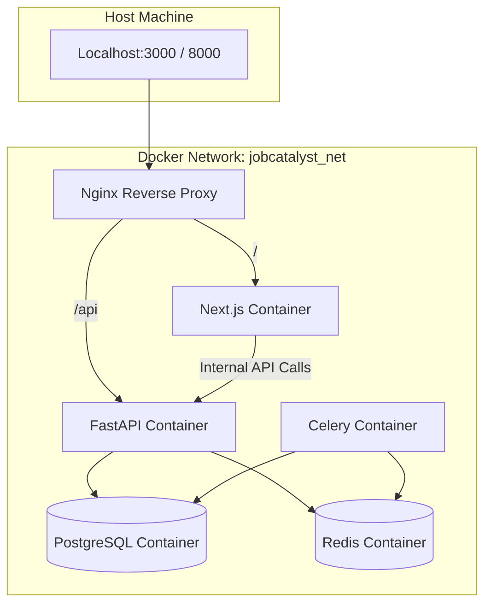
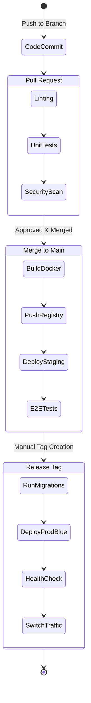
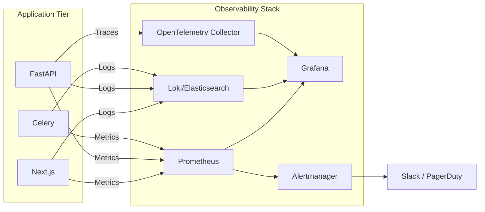

# JobCatalyst AI - DevOps & Deployment Architecture

## 1. Development Environment

**Goal:** Achieving a reproducible, "one-click" setup across all operating systems to reduce onboarding time and eliminate "works on my machine" issues.

*   **Supported OS:** Windows 11 (WSL2), macOS (Apple Silicon/Intel), Linux.
*   **Core Runtimes:** Python 3.13, Node.js 22 (via `nvm` or `fnm`).
*   **Containerization:** Docker Desktop (or OrbStack on macOS for performance).
*   **IDE:** Visual Studio Code (VS Code) with recommended workspace extensions (Python, ESLint, Prettier, Docker, Tailwind).
*   **Version Control:** Git.
*   **Code Quality Enforcement:** `pre-commit` hooks configured for Black/Ruff (Python), ESLint/Prettier (TypeScript), and secret scanning (TruffleHog).
*   **Developer Onboarding:** A single Makefile command (`make setup-dev`) will bootstrap the `.env` files, pull Docker images, run database migrations, and seed mock data.

## 2. Repository Structure & Version Control

**Decision:** Modular Monorepo.

*   **Branch Strategy:** Trunk-based development with short-lived feature branches.
    *   `main`: Always deployable. Represents production state.
    *   `feature/ABC-123`: Branched from `main`, merged via Pull Request.
*   **Commit Convention:** Conventional Commits (e.g., `feat(resume): add parser`, `fix(api): resolve rate limit bug`). Enforced via `commitlint` on pre-commit.
*   **Release Strategy:** Automated semantic versioning (SemVer: `MAJOR.MINOR.PATCH`) driven by commit messages (e.g., `feat` -> minor, `fix` -> patch).
*   **Tagging:** GitHub Actions automatically tags releases (`v1.2.0`) upon successful deployment to production.

## 3. Docker Strategy

*   **Architecture:** Micro-containers operating within a shared isolated Docker network.
*   **Base Images:** Multi-stage builds utilizing minimal base images (e.g., `python:3.13-slim`, `node:22-alpine`) to reduce attack surface and deployment time.
*   **Services Defined in Compose:**
    *   `frontend`: Next.js application.
    *   `api`: FastAPI backend.
    *   `worker`: Celery worker for background jobs.
    *   `db`: PostgreSQL 16.
    *   `cache`: Redis 7.
    *   `proxy`: Nginx for local SSL termination and request routing.
*   **Volumes:** Named volumes for PostgreSQL data (`db_data`) and Redis persistence (`redis_data`) to survive container restarts.
*   **Networks:** Isolated internal network (`jobcatalyst_net`). Only Nginx exposes ports to the host machine.

## 4. Environment Management

*   **Environments:**
    *   `Development`: Local developer machines (Docker Compose).
    *   `Testing/QA`: Automated ephemeral environments spun up per PR.
    *   `Staging`: Exact replica of Production for final integration testing.
    *   `Production`: Live system.
*   **Environment Variables:** Managed via `.env` files locally (never committed).
*   **Secrets Management:** 
    *   *CI/CD:* GitHub Secrets.
    *   *Production/Staging:* AWS Systems Manager Parameter Store or HashiCorp Vault. The application fetches secrets at runtime; they are never baked into Docker images.
*   **Configuration Loading:** Pydantic `BaseSettings` (Backend) and Next.js Environment Variables (Frontend) with strict schema validation on startup.

## 5. CI/CD Pipeline

**Tool:** GitHub Actions.

*   **PR Pipeline (Continuous Integration):**
    *   *Linting & Formatting:* Ruff, Black, ESLint, Prettier.
    *   *Testing:* Pytest (Backend), Vitest/Playwright (Frontend).
    *   *Security Scan:* Bandit (Python), npm audit, Snyk, and Trivy (Container scanning).
*   **Merge Pipeline (Continuous Delivery - to Staging):**
    *   Triggered on merge to `main`.
    *   Builds optimized Docker images.
    *   Pushes to Container Registry (e.g., GitHub Container Registry or AWS ECR).
    *   Executes database migrations against Staging database.
    *   Deploys to Staging environment.
*   **Release Pipeline (Deployment - to Production):**
    *   Triggered by publishing a GitHub Release tag.
    *   Promotes Staging images to Production.
    *   Executes production database migrations (backward compatible only).
    *   Triggers rolling update.
*   **Rollback:** Automated script to revert deployment state to the previous successful tag if post-deployment health checks fail.

## 6. Monitoring & Observability

*   **Metrics:** Prometheus scraping `/metrics` endpoints from FastAPI, Next.js, and Infrastructure components.
*   **Dashboards:** Grafana visualizing Prometheus data (CPU, Memory, Request Latency, Queue Depth).
*   **Application Logs:** Structured JSON logging. Shipped via FluentBit to a central logging cluster (Elasticsearch/OpenSearch or Datadog).
*   **Infrastructure Logs:** Nginx access/error logs and Docker daemon logs collected centrally.
*   **Distributed Tracing:** OpenTelemetry injecting trace IDs into HTTP headers, allowing visualization of requests flowing from Next.js -> FastAPI -> DB/Celery.
*   **Health Checks:** `/health` (Liveness) and `/ready` (Readiness) endpoints on all services.
*   **Alerting:** PagerDuty / Slack alerts triggered by Prometheus Alertmanager for critical thresholds (e.g., Error Rate > 5%, High CPU for > 5 mins, DB connection pool exhausted).

## 7. Backup & Recovery Strategy

*   **Database:**
    *   Continuous: PostgreSQL Write-Ahead Logging (WAL) archiving to S3 for Point-in-Time Recovery (PITR).
    *   Daily: Automated `pg_dump` logical backups to S3.
*   **Uploads:** S3 bucket versioning enabled. Cross-region replication for critical asset buckets.
*   **Logs:** Retained in cold storage (S3 Glacier) for compliance (1 year).
*   **Recovery Objectives:**
    *   *RPO (Recovery Point Objective):* 5 minutes (via WAL).
    *   *RTO (Recovery Time Objective):* 1 hour for automated DB rebuild.
*   **Restore Process:** Documented, automated runbook tested quarterly.

## 8. Scaling Strategy

*   **Horizontal Scaling:** Stateless API and Frontend containers scale horizontally behind the Load Balancer based on CPU/Memory utilization. Celery workers scale based on Redis queue depth.
*   **Vertical Scaling:** Database instance scaled vertically (CPU/RAM/IOPS) as primary scaling mechanism before introducing sharding.
*   **Caching:** Redis for session data, rate limiting, and heavy query result caching.
*   **CDN:** Cloudflare placed in front of the Load Balancer to serve static frontend assets, mitigate DDoS attacks, and cache public API responses.
*   **Auto-scaling:** Configured via Kubernetes HPA or AWS Auto Scaling Groups.

## 9. Windows Desktop Installer Strategy

*   **Framework:** Tauri (Rust-based, extremely lightweight, utilizes native OS webviews) wrapping the Next.js frontend.
*   **Installer:** NSIS (Nullsoft Scriptable Install System) generating a `.exe` installer.
*   **Capabilities:**
    *   *Dependency Check:* Verifies WebView2 runtime is installed on the host.
    *   *Shortcuts:* Creates Start Menu and Desktop shortcuts.
    *   *Auto-Updater:* Integrated Tauri updater checking GitHub Releases for new versions and applying patch updates seamlessly in the background.
    *   *Uninstaller:* Clean removal of application binaries and local `AppData` state.

## 10. Deployment Strategy

*   **Pattern:** Blue-Green Deployment for Production to ensure zero-downtime and instant rollbacks.
    *   *Blue:* Current live environment.
    *   *Green:* New version deployed and tested internally.
    *   *Switch:* Load balancer traffic is swapped from Blue to Green.
*   **Databases:** Schema migrations must be strictly backward compatible (e.g., adding columns, never dropping/renaming in a single deployment) to support Blue-Green routing.

## 11. Disaster Recovery (DR)

*   **High Availability:** Infrastructure deployed across multiple Availability Zones (Multi-AZ) within a primary cloud region.
*   **Failover:** Active-Standby database configuration. If the primary DB fails, the standby is promoted automatically within 60 seconds.
*   **Catastrophic Failure:** In the event of a total region failure, Infrastructure as Code (Terraform) is used to spin up a mirrored environment in a secondary region, restoring state from cross-region S3 backups.

## 12. Documentation

*   **Developer Guide:** Local setup, coding standards, PR process.
*   **Deployment Guide:** CI/CD overview, manual deployment triggers, rollback procedures.
*   **Operations Runbook:** Incident response, scaling up/down, database restore procedures.
*   **Architecture Decision Records (ADRs):** Historical logs of why technical decisions were made.

---

## 13. Mermaid Diagrams

### Infrastructure Architecture (Production)
```mermaid
graph TD
    User((Users)) --> CF[Cloudflare CDN & WAF]
    CF --> ALB[Application Load Balancer]
    
    subgraph Cloud Region (VPC)
        subgraph Public Subnet
            ALB
        end
        
        subgraph Private Subnet - App Tier
            UI[Frontend ASG / K8s Pods]
            API[FastAPI ASG / K8s Pods]
            WKR[Celery Workers ASG]
        end
        
        subgraph Private Subnet - Data Tier
            DB[(PostgreSQL Primary)]
            DB_R[(PostgreSQL Replica)]
            Redis[(Redis Cluster)]
        end
        
        subgraph Private Subnet - Storage
            S3_Assets[S3 Bucket - Resumes]
            S3_Backup[S3 Bucket - Backups]
        end
    end
    
    ALB --> UI
    ALB --> API
    
    UI --> API
    API --> Redis
    API --> DB
    API --> S3_Assets
    
    WKR --> Redis
    WKR --> DB
    WKR --> S3_Assets
    
    DB -. Replication .-> DB_R
    DB -. WAL Archiving .-> S3_Backup
```

### Deployment Strategy (Blue-Green)
```mermaid
graph TD
    Router[Load Balancer]
    
    subgraph Blue Environment (Active)
        V1_API[FastAPI v1.0]
        V1_UI[Next.js v1.0]
    end
    
    subgraph Green Environment (Idle)
        V2_API[FastAPI v1.1]
        V2_UI[Next.js v1.1]
    end
    
    DB[(Shared Database)]
    
    Router == 100% Traffic ==> Blue Environment
    Router -. Swaps to .-> Green Environment
    
    Blue Environment --> DB
    Green Environment --> DB
```

### Docker Architecture (Local Development)


### CI/CD Pipeline


### Observability & Monitoring Flow


---

## 14. Architecture Review

### Infrastructure Review
The designed infrastructure utilizes a robust, industry-standard modern cloud-native approach. By leveraging Docker everywhere, we ensure parity between developer laptops and production servers. The separation of state (DB, S3) from compute (FastAPI, Next.js) allows for seamless horizontal scaling and zero-downtime deployments.

### Potential Risks
1.  **Database Migration Coupling:** Blue-Green deployments require strictly backward-compatible database migrations. A destructive migration (e.g., dropping a column) will break the "Blue" environment while "Green" is deploying.
2.  **Celery Queue Bottlenecks:** If AI processing times spike, the Redis queue could fill up, delaying critical real-time tasks.
3.  **Secrets Sprawl:** Managing secrets across local `.env`, GitHub Actions, and AWS Parameter store can lead to drift if not carefully centralized.

### Recommendations
1.  **Expand-and-Contract Migrations:** Implement a strict rule that database schema changes must follow the Expand-and-Contract pattern (Add new column -> Deploy -> Dual Write -> Deploy -> Migrate Data -> Deploy -> Drop old column).
2.  **Dedicated Queues:** Split Celery queues into `high-priority` (UI updates, emails) and `heavy-compute` (AI parsing) to ensure system responsiveness.
3.  **Infrastructure as Code (IaC):** Mandate the use of Terraform or AWS CDK for *all* infrastructure provisioning to eliminate manual UI clicks in cloud consoles and ensure repeatable disaster recovery.

**Status:** Awaiting architecture approval.
