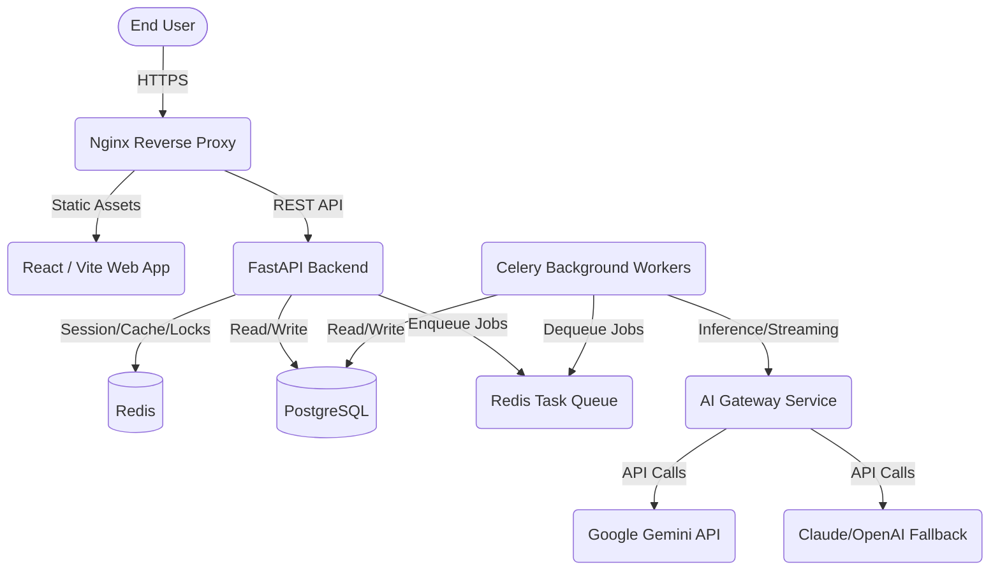
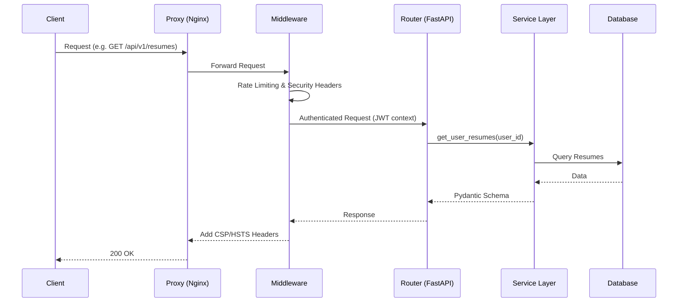

# JobCatalyst AI - System Architecture

## 1. Overview
JobCatalyst AI is an enterprise-grade AI-powered career optimization platform. The system is designed using a **Modular Monolith** architecture for Phase 1/Phase 2 to ensure rapid iteration, simplified deployment, and robust consistency. In Phase 3, performance engineering and security hardening have been applied to prepare the system for enterprise scale.

## 2. High-Level Components

The architecture consists of the following primary tiers:

- **Client Tier**: Web application built with React/Vite, featuring responsive design and state management for seamless user interactions.
- **Gateway/Proxy Tier**: Nginx acts as the reverse proxy, handling SSL termination, rate limiting, and static file serving.
- **API/Service Tier**: A FastAPI backend providing high-performance RESTful APIs, dependency injection, and centralized middleware for security and monitoring.
- **AI Processing Tier**: An AI Gateway (using Gemini API as the primary engine) with prompt caching, structured response parsing, and cost tracking.
- **Persistence Tier**: 
  - **Relational DB**: PostgreSQL for structured data (Users, Resumes, Jobs, Transactions).
  - **Cache/KV Store**: Redis for fast session storage, API rate limiting, response caching, and worker queue management.
- **Asynchronous Tier**: Celery background workers for non-blocking operations like heavy PDF parsing, bulk AI inferences, and report generation.

## 3. System Context Diagram

## 4. Design Principles

1. **Enterprise Scalability**: The Modular Monolith pattern strictly segregates domains (e.g., Auth, Resume, Career Coach). Each module is isolated at the service layer, making future extraction to microservices trivial.
2. **High Performance**: Heavy use of Redis for prompt caching, response caching, and session storage. N+1 query optimization and connection pooling on PostgreSQL.
3. **Defense-in-Depth**: Robust implementation of JWT/Refresh Token rotation, RBAC, input validation (Pydantic), and OWASP Top 10 mitigation strategies.
4. **Reliability & Resilience**: Circuit breakers and fallback mechanisms for AI endpoints. Celery retry policies for transient failures.
5. **Observability**: Centralized logging, token usage tracking, and performance monitoring.

## 5. Domain Boundaries

The application logic is partitioned into the following domains:

- **Auth & IAM**: User registration, JWT handling, role-based access control.
- **User Profile**: Core user metadata, settings, and preferences.
- **Resume Engine**: CRUD for resumes, version control, and template mapping.
- **ATS Analyzer**: AI-driven resume parsing, gap analysis, and keyword optimization.
- **Job Matcher**: Job search integration, AI-powered semantic matching, and saved jobs.
- **Career Coach**: Chat sessions, actionable advice, and progress tracking.
- **Workflow Orchestrator**: Automated event-driven triggers for complex multi-step pipelines.
- **Admin Portal**: System configuration, user management, and token telemetry.

## 6. Request Lifecycle

## 7. Next Steps & Reading

- [Backend Architecture](./BACKEND_ARCHITECTURE.md)
- [Frontend Architecture](./FRONTEND_ARCHITECTURE.md)
- [Database Architecture](./DATABASE_ARCHITECTURE.md)
- [Security Architecture](./SECURITY_ARCHITECTURE.md)
